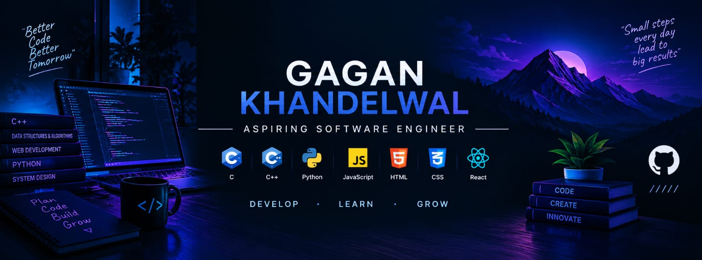

# Hi 👋, I'm Gagan Khandelwal

### 💻 Aspiring Software Engineer | BTech CSE Student

Welcome to my GitHub profile!

I'm a Computer Science Engineering student passionate about programming, problem-solving and web development.

### 🚀 About Me

- 🎓 BTech CSE Student
- - 💻 Currently learning C++ and DSA
- 🌐 Building projects using HTML, CSS and JavaScript
- 🌱 Exploring Full Stack Development
- 🌐 Interested in Frontend Development
- 🌱 Exploring Full Stack Development
- 🎯 Working towards becoming a Software Engineer
- ♟️ Interested in Chess and Technology

### 🛠️ Technical Skills
## 💻 Languages & Technologies

### 👨‍💻 Programming Languages

### 🌐 Frontend Development

### 🛠️ Tools & Platforms

### 📂 My Projects

Here are some projects I've built while learning and improving my development skills:

## 🚀 Featured Projects

### 🤖 Nexa AI Virtual Assistant
AI-powered virtual assistant built using web technologies.
live link:- https://gagankdev.github.io/Nexa--AI-Virtual-Assistant/

### ⛳ Family Golf Website
Modern and attractive golf-themed website.
live link:- https://gagankdev.github.io/Family_Golf/

### 🗣️ Text-to-Speech Converter
Converts written text into spoken audio.
live link:- https://gagankdev.github.io/Text-to-voice-convertor/

### 📱 QR Code Generator
Generates QR codes from text and URLs.
live link:- https://gagankdev.github.io/QR-Code-generator/

### 🌸 Flower E-commerce Website
Frontend e-commerce website using HTML and CSS.
live link:- https://gagankdev.github.io/responsive-e-commerce-flower-web/

### 🌦️ Weather Application
Weather information application using an API.
live link:- https://gagankdev.github.io/Weather-App/

### 🎮 Rock Paper Scissors
Interactive browser-based game.

### ✅ To-Do List
Task management application.

### 💼 Personal Portfolio
Personal website showcasing my skills and projects.### 📚 Currently Learning

- C++ Programming
- Data Structures & Algorithms
- Problem Solving
- Node.js

### 🎯 My Goals

- Strengthen my programming fundamentals.
- Improve my DSA problem-solving skills.
- Build real-world projects.
- Become internship-ready.

### 🤝 Connect With Me

  
  
  

## 📊 GitHub Statistics

## 💻 Most Used Languages

---

## 🔥 GitHub Contribution Streak

⭐ Thanks for visiting my profile!
